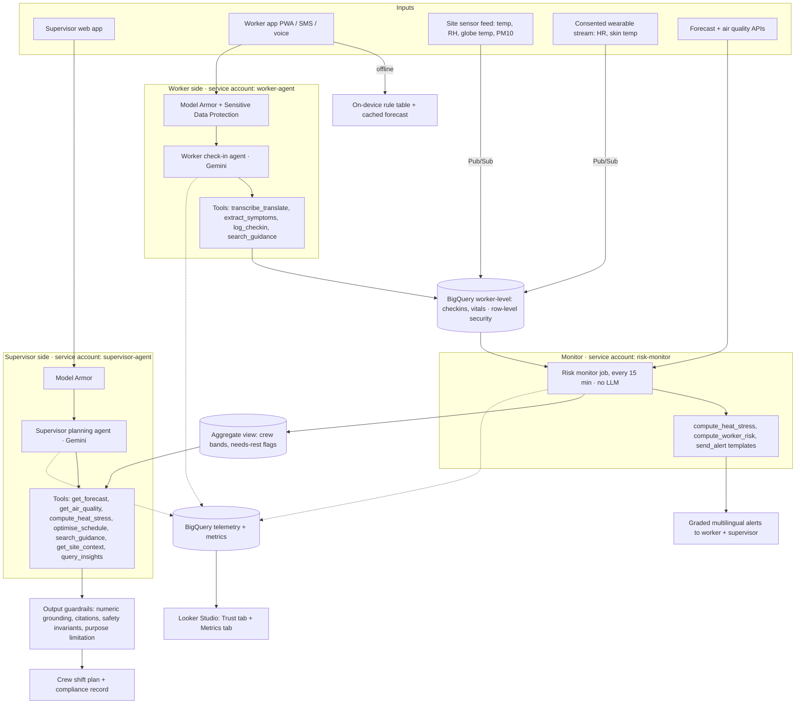
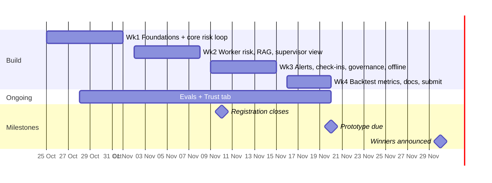

# Heat-Safe Crew Agent: Architecture & Build Plan (Abu Dhabi)

Revised 30 Oct 2026 · Future Health Digital Innovation Challenge · Population Health → **Climate-Resilient Worker Health**

## Overview

Two narrow agents and a deterministic risk monitor on GCP combine the heat forecast, site sensors, workload, PPE and optional consented wearable signals into a **graded, multilingual early warning per worker and per crew**. It turns that into a safe shift plan for the supervisor. It keeps working offline with a rule-based fallback, it keeps individual health data away from the employer, and it proves its own trustworthiness through guardrails, evals and BigQuery telemetry.

- **Persona:** a construction site supervisor in Mussafah, Abu Dhabi, planning shifts for a mixed crew of roofers, steel fixers and labourers in August. One persona, one region, end to end.
- **Second user:** the worker, who gets alerts and does check-ins in their own language on a basic phone.
- **Pitch line:** *Worker protection before productivity. Code computes and enforces, the LLM explains and plans, and every number and rule is grounded and logged.*

### What it does

1. Computes hourly heat stress per site as the **Thermal Work Limit (TWL)**, the index Abu Dhabi's ADOSH-SF CoP 11.0 requires, with WBGT alongside for display, from forecast and site-sensor data, then adjusts it per worker for workload, clothing/PPE, acclimatisation, hydration and cumulative exposure. This is all code, never the LLM.
2. Optionally adds consented wearable signals (heart rate, skin temperature) to estimate rising physiological strain per worker.
3. Sends **graded warnings** (Green / Amber / Red / Emergency) to workers in their language and to the supervisor, each with a fixed safe action: hydrate, rest, cool, reduce intensity, rotate, stop work or escalate clinically.
4. Plans the day for the supervisor: task timing, work/rest cycles, rotation and stop-work hours. It applies the UAE midday break as a hard rule and cites guidance for each recommendation.
5. Runs multilingual voice check-ins and escalates red-flag symptoms on a deterministic path.
6. Shows the supervisor **crew- and site-level views only**. Individual clinical detail never reaches them.
7. Reports safety and productivity metrics: alert lead time, false-alarm rate, adherence, symptoms and incidents, escalations, compliance and lost work time.
8. Shows a Trust tab: guardrail trips, eval pass rates, tool trajectories, latency and cost.

## Challenge fit

Each of the six "Your solution should" items maps to a concrete feature and a demo moment.

| # | Challenge requirement | How we meet it | Shown in demo |
|---|---|---|---|
| 1 | Dynamic heat-risk assessment | `compute_heat_stress` (site TWL zone, WBGT for display) plus `compute_worker_risk` (workload, PPE, acclimatisation, hydration, cumulative heat dose, optional HR / skin temperature) → individual and crew risk bands, updated every 15 minutes | Risk rises through the morning; the new starter turns Amber before the rest of the crew |
| 2 | Clear, graded, multilingual warnings | 4 severity levels; each level has fixed actions in **pre-translated, human-reviewed templates** (Arabic, Hindi, Urdu, Malayalam, Bengali, Tagalog, English); text-to-speech and SMS for basic phones | A Malayalam-speaking worker gets a Red alert with "stop, shade, water, tell supervisor" |
| 3 | Worker-first governance | Opt-in consent per data type, data minimisation, BigQuery row/column-level security, retention limits, purpose-limitation guardrail that refuses disciplinary or ranking queries | Supervisor asks "who complains most?" and the agent refuses; the refusal is logged |
| 4 | Field-ready operation | Offline-capable worker app (PWA) with an on-device rule table, SMS fallback, sensor-loss fail-safe that *raises* the risk band, stale-data detection, dust and PPE factors | Network cut mid-shift; the app still warns from cached forecast and rules; data syncs later |
| 5 | Supervisor decision support | Crew/site dashboard: risk by crew and hour, recommended breaks, rotation and task timing; individuals shown only as "needs rest now", never with vitals or symptoms | Morning plan moves roofing to 05:30–10:00 and adds a rotation |
| 6 | Safety and productivity measures | **Built (15 Nov):** a replay-day comparison of one crew under no plan, the morning plan, and Heat-Safe, judged against measured heat: minutes over the ADOSH-SF work limit, work by zone, midday-break and withdrawal compliance, detection delay, faults caught, false withdrawals, work delivered, shortfall, minutes cut and moved, alerts (`doc/metrics_replay_2025-08-01.md`). Full-summer backtest: roadmap | The comparison table |

## Architecture

The system has two agents with separate data permissions and one non-agent pipeline. The worker's health data and the employer's planning tool never share credentials, so requirement 3 is enforced by IAM, not only by prompts. Alerts never wait on an LLM: the risk monitor fires them deterministically, and the same rule table runs offline on the worker's phone.

| Part | Type | Users | Can access |
|---|---|---|---|
| **Supervisor planning agent** | ADK agent (Gemini) on its own Cloud Run service and service account | Supervisor | Forecast, site heat stress, schedule optimiser, guidance search, site notes, **crew/site aggregate views only** |
| **Worker check-in agent** | ADK agent (Gemini), narrow scope, own Cloud Run service and service account | Worker | Speech-to-Text and translation, symptom extraction, that worker's own records, guidance search; emits only a band and a "needs rest" flag |
| **Risk monitor and alerting** | Not an agent: Pub/Sub + Cloud Run job every 15 min | — | Sensor and wearable streams, `compute_worker_risk`, pre-translated alert templates, `send_alert` |

The worker side reaches the supervisor side **only** through an aggregated BigQuery view (or an A2A message) carrying "Worker 7: Red, needs rest now". That handoff is requirement 5 built into the architecture.

## Components

Everything runs on GCP. Both agents are built with ADK on Cloud Run with Gemini, each with its own service account. BigQuery is the single store for data, vectors and telemetry, and Pub/Sub ingests sensor and wearable streams. Guardrails are Model Armor plus code checks. Shared tool code lives in one Python package (`src/heat_safe`), and each service imports only the tools it is allowed to use.

### Tools

Status as of 30 Oct 2026.

| Tool | What it does | Used by | Deterministic? | Priority | Status |
|---|---|---|---|---|---|
| `get_forecast` | Hourly temperature, humidity, wet bulb, surface pressure, wind, shortwave / direct / diffuse radiation and UV index (forecast only) for the configured sites (Open-Meteo). `get_replay(day)` **replays a past date** from the cached ERA5 files, falling back to the historical archive API | Supervisor agent, monitor | Yes | Must | Built: `forecast.py` |
| `compute_heat_stress` | Site TWL per hour (Brake & Bates 2002 heat balance; globe and natural wet bulb by the Liljegren method from forecast, or measured when a site sensor is present), in sun and in shade → ADOSH-SF TWL zone and risk band; withdrawal limits; WBGT for display; minutes of each hour inside the UAE midday break; work minutes per hour for light and heavy work; heat-programme flag at ≥ 35 °C; missing input → Red | Supervisor agent, monitor | Yes, pure code | Must | Built: `heat_stress.py`, `thermal.py`, `twl.py`, `rules.py`. Measured-sensor override not yet |
| `compute_worker_risk` | Applies the TWL zone controls for the worker's work intensity (light/heavy), adjusts for metabolic rate (task), clothing/PPE adjustment, acclimatisation days, cumulative heat dose and hydration; adds physiological strain from consented HR / skin temperature → individual band; aggregates to crew | Monitor only | Yes, pure code | Must | Week 2 (acclimatisation tables already in `rules.py`) |
| `lookup_job_profile` | Maps a role (roofer, steel fixer, labourer, driver, plus aliases) to ADOSH-SF work intensity (light/heavy), ISO 8996 metabolic class and rate, typical PPE, clothing insulation (clo) and O*NET heat-exposure context (US proxy) | Supervisor agent, monitor | Yes | Must | Built: `job_profile.py` |
| `get_air_quality` | PM10 / PM2.5 / dust for dust-storm days (Open-Meteo Air Quality, CAMS) | Supervisor agent, monitor | Yes | Should | Week 2 (data downloaded) |
| `get_site_context` | Retrieves today's pre-start notes and photo findings for the site | Supervisor agent | Retrieval | Must | Week 2 |
| `search_guidance` | RAG over the curated guidance corpus; returns chunks with a copyable citation (`<doc>, p. N`) and authority level, ranked with binding Abu Dhabi documents first | Both agents | Retrieval | Must | Built: `corpus.py`, `guidance.py`, `tools/build_corpus.py` (14 documents, 1,574 chunks) |
| `optimise_schedule` | Reorders tasks into cooler hours, inserts rest and rotation within risk-band rules; **never trades a safety rule for output** | Supervisor agent | Yes | Must | Week 2 |
| `transcribe_translate` | Speech-to-Text (Chirp) and translation of a voice check-in | Worker agent | Yes | Must | Week 3 |
| `extract_symptoms` | Gemini structured extraction of symptoms, hours worked and water intake | Worker agent | LLM, schema-checked | Must | Week 3 |
| `log_checkin` | Writes extracted check-in fields to BigQuery (worker-scoped table) | Worker agent | Yes | Must | Week 3 |
| `send_alert` | Sends a pre-translated template alert to an allowlisted worker or supervisor; rate-limited; level-gated | Monitor; worker agent for red-flag escalation only | Yes, side effect | Must | Week 3 |
| `get_site_sensor` | What the site sensor measured per hour against the forecast (worst TWL, how much worse), faulty readings excluded; with the crew, the risk monitor's alerts and whether it recommends a re-plan. `optimise_schedule(replan_from, use_site_sensor)` then re-plans from the next whole hour. SYNTHETIC sensor for the 1 Aug 2025 replay only | Supervisor agent | Yes | Must | Built 14 Nov: `sensor.py`, `spike.py`, `agent_tools.py`; evals `spike_replan`, `sensor_fault_not_heat` |
| `query_insights` | Read-only SQL over **aggregated** analytics views only (crew/site, never per-worker health) | Supervisor agent | Yes, SQL-guarded | Should | Week 3 |

### Code layout

| Path | Content |
|---|---|
| `src/heat_safe/sites.py` | Site coordinates (`abu_dhabi_city`, `mussafah`, `al_ain`, `ruwais`) and time zone (Asia/Dubai) |
| `src/heat_safe/forecast.py` | `get_forecast`, `get_replay` |
| `src/heat_safe/thermal.py` | Solar zenith, globe temperature, natural wet bulb, mean radiant temperature, WBGT (thermofeel 2.3.0 Liljegren) |
| `src/heat_safe/twl.py` | Thermal Work Limit heat balance (port of the MIT-licensed R package meteoHazard) |
| `src/heat_safe/rules.py` | Versioned thresholds (`RULES_VERSION`): TWL zones and controls, withdrawal limits, acclimatisation, 35 °C programme trigger, midday break by year, `Band` ordering |
| `src/heat_safe/heat_stress.py` | `compute_heat_stress`, `daily_summary` |
| `src/heat_safe/job_profile.py` | `lookup_job_profile` |
| `tests/` | 103 tests: TWL against 63 published cases, zone and midday-break boundaries, fail-safe, replay day |
| `tools/download_data.py` | Downloads all public data, writes `data/manifest.json` |
| `tools/load_bigquery.py` | Creates the five datasets and loads `raw` tables |
| `src/heat_safe/schedule.py` | `optimise_schedule` (first version: best hours within zone limits, midday break, unacclimatised rule, shortfall) |
| `src/heat_safe/grounding.py` | Numeric and citation grounding checks on agent answers |
| `src/heat_safe/corpus.py` | Guidance documents with authority tiers; PDF extraction, header removal, page-bounded chunking |
| `src/heat_safe/guidance.py` | `search_guidance`: query embedding, BigQuery `VECTOR_SEARCH`, authority re-rank; learning notes in `src/heat_safe/README_RAG.md` |
| `tools/build_corpus.py` | Embeds chunks (cached by content hash) and loads `vectors.guidance_chunks` |
| `src/heat_safe/agent_tools.py` | JSON wrappers the supervisor agent calls |
| `agents/supervisor/` | Supervisor planning agent (ADK, Gemini via `global`), BigQuery telemetry plugin |
| `evals/` | Golden scenarios (9 supervisor, 21 retrieval), scorers and runners; learning notes in `evals/README.md` |
| `tools/ask_supervisor.py` | Ask the agent from the terminal (`HEAT_SAFE_TODAY=2025-07-31` for the replay demo) |

### Risk model (code, not LLM)

1. **Site TWL** per hour (W/m²): computed from forecast (temperature, humidity, wind, solar → globe and mean radiant temperature) or measured when the site has a TWL meter. Measured values override forecast values. Computed both in sun and in shade, so the planner can move work into shade. Withdrawal limits (dry bulb > 44 °C or wet bulb > 32 °C) force the High zone.
2. **Zone → controls** from ADOSH-SF Technical Guideline v4.0 Table 1: Low (TWL ≥ 140) / Medium (115–140) / High (< 115) map to Green / Amber / Red, with work/rest cycles and fluid intake per work intensity (light or heavy). Unacclimatised workers may work only in the Low zone, and no one works alone in the Medium or High zone. PPE enters as clothing insulation in the TWL calculation per worker (default 0.6 clo, long-sleeved work wear). The midday break removes outdoor minutes from 12:30–15:00 before work/rest is applied, and any shift reaching 35 °C flags that a heat stress programme is required (CoP 11.0 §3.1).
3. **Modifiers** raise the band, never lower it: acclimatisation (built 6 Nov in `acclimatisation.py`, option B: new starters, including people moving from an air-conditioned job, work only in the Low zone through day 7, the protective end of CoP 11.0 §3.2(b)(i)'s "5-7 days", at the TG §3 workload share of 20/40/60/80/100 % (50/60/80/100 % if experienced in heat); returning workers follow the TG re-acclimatisation table, e.g. 80 % on the first day back after 6–11 days away, and anyone off more than 14 days is unacclimatised by TG Table 1 note b, so Low zone only for 7 days; the scheduler caps work at that share), low reported water intake, symptoms in last check-in, high cumulative heat dose so far today, fasting during Ramadan, dust advisory (respirator use).
4. **Optional physiology** (consented only): estimated core temperature from heart rate (ECTemp-style Kalman filter) → Physiological Strain Index. A rising trend can raise the band early; missing data never lowers it.
5. **Crew risk** = the highest individual band in the crew plus the share of workers at Amber or above.
6. **Fail-safe:** a site-hour with a missing weather input has no environmental band to raise, so it is **Red** with a `data_issue` note (built). Stale forecast (> 3 h), sensor dropout or wearable loss → fall back to the environment-only band **plus one level**, and tell the supervisor which input is missing (Week 2). Raising caps at Red; **Emergency** comes only from red-flag symptoms, never from environment alone.

Thresholds live in versioned code (`rules.py`, `RULES_VERSION`) and are unit-tested. They are never retrieved from RAG or generated by the LLM.

### Graded warnings

| Level | Trigger (example) | Worker action (template) | Supervisor action |
|---|---|---|---|
| Green | TWL Low zone (≥ 140 W/m²), no modifiers | Drink water every 15–20 min | Normal plan |
| Amber | TWL Medium zone (115–140 W/m²), or Low zone plus one modifier | Drink 1 cup every 15 min, rest in shade at the scheduled break | Enforce work/rest cycle, rotate high-exertion tasks |
| Red | TWL High zone (< 115 W/m²) or a withdrawal limit, Medium zone plus a modifier, missing data, or a red-flag symptom trend | Follow your work/rest times, drink every 15 min, stop and tell your supervisor if unwell; **"Stop work now" only when an alert fires** (see below) | Enforce the High-zone cycle; on an alert: remove worker from heat, check in within 10 min |
| Emergency | Red-flag symptoms (confusion, collapse, vomiting, stopped sweating) | Call for help; buddy stays with worker | Call **998**, start cooling, deterministic escalation |

**Band, reminder, alert (decided 7 Nov):** the band is a state and is shown, not pushed. Planned controls (work/rest, fluids) arrive as scheduled reminders. Alerts fire only on a deviation from the stored plan: band above the planned band, a new risk factor, a withdrawal limit, a lost input, or a red flag (Emergency, never rate-limited). Otherwise a planned Red day would alert every 15 minutes. Spec: `src/heat_safe/README_WORKER_RISK.md`.

Alert text comes from **fixed templates translated in advance and reviewed by native speakers**. The LLM can explain why an alert fired, but it never writes the safety instruction in a language nobody on the team can check.

**Built 14 Nov** (`src/heat_safe/alert_templates.yaml`, `alerts.py`): `tighten`, `rest_now`, `sensor_fault`, `withdraw` and `emergency` (998, not yet triggered automatically), for the worker in English, Mandarin, Hindi, Urdu, Malayalam and Bengali, plus a crew-level English line for the supervisor with no health detail. Each language records its review status, which decides how it is sent. English is the source. **Mandarin: reviewed by a native speaker on the team (14 Nov), sent alone. Hindi, Urdu, Malayalam, Bengali: AI drafts back-translated with Google Translate and cross-checked with a second translation tool (meaning confirmed), not yet native-reviewed, so always sent together with the English text.** Any future unchecked language is a draft: marked in demo mode, refused in production (English instead). Alerts are logged, not sent (SMS, push and voice are on the roadmap).

### Unstructured inputs

| Input | Processing | Lands in | Priority |
|---|---|---|---|
| Worker voice check-ins | Speech-to-Text (Chirp) in the worker's language → Gemini extracts symptoms, hours, water intake | `checkins` (worker-scoped) | Must |
| Pre-start and handover notes | Gemini extracts risk factors (new starter, broken cooling unit, confined space, heavy PPE task) | `site_notes` + vector index | Must |
| Site photos | Gemini vision flags shade, water/cooling stations, PPE type | `site_photo_findings` | Stretch |
| Incident narratives (mock) | Extraction into structured fields + embedding | `incidents` + vector index | Should |

### RAG corpus

Built 6 Nov: 14 documents (incl. MoHRE/WAM midday-break releases 2024–2026) → 1,574 chunks (≤ 1,200 characters, one page each) → `gemini-embedding-001` (768 dimensions, me-central1) → BigQuery `vectors.guidance_chunks`, searched with exact `VECTOR_SEARCH` (no index below 5,000 rows). Each document has an authority tier (1 binding regulation for an Abu Dhabi site: ADOSH-SF and MoHRE, 2 UAE/Abu Dhabi data law, 3 international guidance, 4 other emirate); a small tier bonus, chosen with the retrieval eval, puts binding documents first (top result binding 54% → 100%). TG Table 1 is an image in the PDF, so its hand-checked transcription is added as text. Answers must copy the tool's citation, and every page reference is checked against tool output. Thresholds are never retrieved; they live in `rules.py` and are applied by `compute_heat_stress` and `compute_worker_risk`. File locations and the full status list are under [Data sources](#data-sources).

- **Have:** ADOSH-SF CoP 11.0 *Safety in the Heat* v4.0 and its Technical Guideline v4.0 (Jul 2024, issued through the Abu Dhabi Public Health Centre); ADOSH-SF CoP 53.1 *OSH in Construction*; ILO *Working on a warmer planet* (2019); NIOSH 2016-106 heat-stress criteria; WHO/WMO *Heatwaves and health: guidance on warning-system development* (2015); WHO heat fact sheet; Sharjah OSHJ-CoP-33 (2024, reference only, not Abu Dhabi law); UAE PDPL (FDL 45/2021, English); Federal Law 2/2019 on ICT in health; DoH ADHICS FAQ
- **To collect by hand:** MoHRE midday-break announcements (2024, 2025); NCM warning text samples (extreme heat, dust, fog); WHO/WMO *Climate change and workplace heat stress* (2025); MoHRE Ramadan working hours and the Labour Law (FDL 33/2021); CoP 11.0 in Arabic
- **To write (mock):** contractor heat-stress management plan, labour accommodation and transport note, site emergency response plan

## Worker-first governance

The worker owns their health data, the supervisor sees actions, and nobody sees rankings. Every rule below is enforced in code or IAM, not just in a prompt.

| Control | Implementation | Priority |
|---|---|---|
| Informed consent | Consent screen in the worker's language, separate opt-in for check-ins, wearable HR and skin temperature; withdraw any time; consent state checked before every read | Must |
| Data minimisation | Store only what the risk model uses; no location tracking beyond site check-in; no raw audio kept after transcription | Must |
| Agent separation | Supervisor agent's service account has no IAM access to worker-level tables; only the worker agent and the risk monitor can read them | Must |
| Access rules | BigQuery row-level security and policy tags: supervisor role sees crew aggregates and "needs rest" flags; only the worker (and an occupational health role) sees individual vitals and symptoms | Must |
| Purpose limitation | Guardrail refuses queries that rank, score or compare individual workers for performance, discipline, hiring or attendance; refusals logged to telemetry | Must |
| Retention | Table/partition expiration on worker-level health data (e.g. 30 days in the prototype); aggregates kept longer | Should |
| Audit | Cloud Audit Logs plus agent telemetry show who accessed which worker-level data | Should |
| Regulatory alignment | Document alignment with UAE Federal Decree-Law 45/2021 (PDPL) and Abu Dhabi DoH health data rules; listed as an assumption for legal review, not a claim of compliance | Should |

## Field-ready operation

The worker app and the alert path must work without the LLM and without the network. A hackathon cannot run a summer field trial, so we demonstrate this with fault-injection tests and a replayed summer day.

| Condition | Fallback | Test |
|---|---|---|
| Network loss on site | PWA keeps the cached forecast and the rule table and alerts locally; check-ins queue and sync later; SMS for basic phones | Airplane-mode demo; queued check-in syncs |
| Sensor or wearable failure | Environment-only band **+1 level**; supervisor told which input is missing | Kill the simulated sensor stream mid-replay |
| Stale or missing forecast | Last good forecast + conservative band; alert after 3 h stale | Block the API in the test harness |
| Dust storm | Dust raises the band (respirator effort) and shows a dust advisory | Replay a past dust event |
| Heavy PPE / coveralls | Clothing adjustment in `compute_worker_risk` | Golden scenarios per PPE type |
| Battery | Low-frequency wearable sampling; the app works on a basic phone via SMS | Documented as an assumption |
| Agent or guardrail error | Fail safe: escalate instead of going silent | Golden eval scenarios |

## Supervisor decision support

- **Site view:** hourly risk band per crew for today and tomorrow, with the midday break and recommended stop-work windows marked.
- **Crew plan:** recommended task order, work/rest cycles, rotation between high- and low-exertion tasks, and the guidance cited for each.
- **Live board:** count of workers at each band and "needs rest now" actions. Individuals appear by name or ID only with an action, never with vitals, symptoms or history.
- **Natural-language questions** through `query_insights`, limited to aggregated views ("How many Red alerts did crew B have this week?").

## Safety and productivity measures

**Built for the prototype (15 Nov): one replayed day, not a backtest.** `tools/replay_metrics.py` compares the same crew (steel fixers in shade, 5 h) under A. no plan, B. the morning plan only and C. Heat-Safe, judged against the measured (synthetic) sensor heat, and writes `doc/metrics_replay_2025-08-01.md`. Result: minutes worked over the ADOSH-SF work limit A 280, B 20, C 0; C delivers 255 of 300 minutes, and the 45 it does not deliver is reported as a shortfall, not squeezed into unsafe heat. No illness is simulated, so the safety measure is limit exceedance, not illness prevented. Adherence, symptoms and escalations need the worker app (roadmap).

*Original target (roadmap):* all metrics computed in BigQuery views and shown in a Looker Studio Metrics tab, from a **backtest over a full past Abu Dhabi summer (Jun–Sep) with synthetic crews**, with synthetic heat-illness events from a documented simulation, labelled as such.

| Metric | Definition (prototype) |
|---|---|
| Alert lead time | Minutes between the first Amber/Red alert and a simulated symptom onset event |
| False-alarm rate | Share of Red alerts with no exceedance or symptom within the following 60 min |
| Missed-event rate | Simulated symptom events with no prior Amber or higher alert (target: 0 in golden set) |
| Adherence | Share of recommended breaks and rotations acknowledged in the app |
| Symptoms and incidents | Check-in symptom reports and incidents per 1,000 worker-hours, by band |
| Emergency escalations | Count and time-to-supervisor-acknowledgement |
| Compliance | Share of shifts with zero outdoor work in the midday break window, and with rest cycles applied |
| Lost work time | Hours moved or stopped for heat, versus a no-plan baseline |

## Guardrails

| Layer | Guardrail | Built with | Priority |
|---|---|---|---|
| Input | Prompt injection and jailbreak screening on check-in text and transcripts | Model Armor | Must |
| Input | PII and health-data redaction before embedding or logging | Sensitive Data Protection / Model Armor | Must |
| Tool | SQL guard: SELECT only, allowlisted **aggregate** views, dry run, `maximum_bytes_billed` | sqlglot + BigQuery dry run; read-only service account | Must |
| Tool | `send_alert`: recipient allowlist, rate limit, template-only text, human approval for non-standard alerts | Code | Must |
| Tool | Consent check before any worker-level read | Code + IAM | Must |
| Agent boundary | Separate service accounts per agent; the supervisor agent cannot read worker-level tables even if prompted to | IAM | Must |
| Output | Numeric grounding: every TWL / WBGT / temperature / band matches tool output | Code | Must |
| Output | Safety invariants: no "safe to continue" at Red or above; no outdoor work planned in the midday break window; red flags always escalate | Code | Must |
| Output | Purpose limitation: no individual ranking, scoring or disciplinary framing | Code + Model Armor | Must |
| Output | Citation check: policy claims map to a retrieved chunk | Code | Should |
| Output | Medical-advice boundary; 998 path present when needed | Code + Model Armor | Should |
| Any | Fail safe: a guardrail or tool error during a check-in escalates instead of going silent | Code | Must |

## Evals

- **Golden set** of 20–25 scenarios, split into a supervisor-agent suite and a worker-agent suite, with expected tool trajectories, scored with trajectory metrics (exact, in-order, precision, recall) in ADK eval or the Vertex AI evaluation service. Include scenarios for PPE types, new starters, Ramadan, dust, sensor dropout, offline mode and purpose-limitation red-team prompts.
- **Risk model unit tests:** TWL against Brake & Bates (2002) Table 1 (63 published cases); WBGT against the thermofeel reference implementation; band boundaries; midday-break boundaries; "missing data never lowers risk" (103 tests, all passing).
- **Response metrics:** correctness against computed values, invariant pass rate, safety.
- **RAG metrics:** faithfulness, context precision and recall.
- **Extraction metrics:** symptom recall on gold check-in transcripts in each language; a missed red flag fails the run.

## Observability

Agent events, tool calls, guardrail decisions and eval results stream to BigQuery via ADK's BigQuery logging plugin. Sensor and wearable streams arrive through Pub/Sub. Looker Studio shows two tabs:

- **Trust tab:** guardrail trips by type, refusals, tool error rates, latency and token cost per run, eval pass rates over time.
- **Metrics tab:** the safety and productivity measures above.

## Data sources

Weather, air quality, standards, guidance and occupation data are real and public. Anything about specific workers, sites, wearables or incidents is synthetic and labelled that way in the demo.

`uv run python tools/download_data.py` fetches every automatic source (idempotent; `--force` refreshes) and records each file's URL, retrieval time and status in `data/manifest.json`. Last run: 48 files, 0 failures. `uv run python tools/load_bigquery.py` loads the tabular data into BigQuery `raw` in `future-health-513202` (me-central1), replacing each table on every run. `data/raw/` and `data/processed/` are gitignored, so a fresh clone runs the script first. Hourly times are local (Asia/Dubai); sites are in `src/heat_safe/sites.py`. Inventory details: `data/README.md`.

#### Real data: downloaded

Paths are under `data/`.

| Data | Source | Coverage | Path | BigQuery `raw` table (rows) | Used by |
|---|---|---|---|---|---|
| Hourly forecast | [Open-Meteo Forecast API](https://open-meteo.com/en/docs), no key | 16 days, 4 sites, incl. UV; one snapshot per download day (29 and 30 Oct 2026) | `raw/weather/forecast_snapshot_<date>.csv` | `weather_forecast_snapshot` (3,072) | `get_forecast` live path |
| Historical hourly weather | [Open-Meteo Historical API](https://open-meteo.com/en/docs/historical-weather-api) (ERA5) | Replay days 1 Aug 2025 (heat) and 4 Aug 2024 (dust); 1 Jun–30 Sep 2023, 2024, 2025; 4 sites | `raw/weather/era5_*.csv` | `weather_era5_hourly` (35,136) | `get_replay`, backtest, Metrics tab |
| Air quality and dust | [Open-Meteo Air Quality API](https://open-meteo.com/en/docs/air-quality-api) (CAMS) | PM10, PM2.5, dust, aerosol optical depth, UV, US AQI: forecast snapshots, both replay days, summers 2023–2025 | `raw/air_quality/` | `air_quality_cams_hourly` (35,136), `air_quality_forecast_snapshot` (960) | `get_air_quality`, dust modifier |
| Station observations | NOAA NCEI GSOD | Daily 2020–2025: Abu Dhabi Intl, Al Bateen, Al Ain Intl | `raw/noaa_gsod/` | `noaa_gsod_daily` (6,125; missing-value sentinels left in) | Validate ERA5 |
| Reanalysis cross-check | NASA POWER | Mussafah hourly for both replay days; daily summers 2023–2025 | `raw/nasa_power/` | `nasa_power_hourly` (48), `nasa_power_daily` (366) | Cross-check ERA5 |
| Occupation exposure | O*NET 30.1 Work Context (US proxy, labelled as such) | Full database, plus an extract for the four roles | `raw/onet/`, `processed/onet_work_context_plan_roles.csv` | `onet_work_context` (297,676), `onet_work_context_categories` (281), `onet_occupation_data` (1,016) | `lookup_job_profile` |
| Abu Dhabi heat code | ADPHC: ADOSH-SF CoP 11.0 *Safety in the Heat* v4.0 and Technical Guideline v4.0 (Jul 2024) | TWL zones, work/rest, fluid, acclimatisation, heat programme | `raw/regulatory/adosh_sf_*_safety_in_the_heat_v4_2024_en.pdf` | — | `rules.py`, RAG corpus |
| Construction OSH code | ADPHC: ADOSH-SF CoP 53.1 *OSH in Construction* | | `raw/regulatory/adosh_sf_cop_53_1_osh_construction_en.pdf` | — | RAG corpus |
| Code of practice index | ADPHC Codes of Practice page | Version check for CoP 11.0 | `raw/regulatory/adphc_codes_of_practice_index.html` | — | Citation reference |
| Guidance | ILO 2019; NIOSH 2016-106; WHO/WMO 2015 warning systems; WHO heat fact sheet; Sharjah OSHJ-CoP-33 (2024, reference only) | | `raw/guidance/` | — | RAG corpus |

#### Real data: collected by hand

In `data/raw/regulatory/manual/`, listed in the manifest with status `manual`.

| Data | File | Used by |
|---|---|---|
| TWL zone table, transcribed from Technical Guideline v4.0 Table 1 (p. 5) and checked against the PDF | `twl_zones_adosh_tg_v4.csv` | Source record for the values in `rules.py` (`RULES_VERSION` 2026.10.30-1; now 2026.11.06-1) |
| UAE PDPL, Federal Decree-Law 45/2021 (English) | `uae_pdpl_fdl_45_2021_en.pdf` | Governance, RAG corpus |
| Federal Law 2/2019 on ICT in health fields | `uae_health_ict_law_2_2019_en.pdf` | Governance, region assumption |
| Abu Dhabi DoH ADHICS FAQ | `ADHICS-FAQ.pdf` | Governance |
| MoHRE midday break / Occupational Heat Stress Prevention Policy: WAM releases 31 May 2024, 3 Jun 2025, 8 Jun 2026, 15 Sep 2026 (hours, dates, exemptions, fines AED 5,000 per worker up to 50,000 in 2024–25) | `../middaybreakannouncements/WAM_*.pdf` | Source for the midday-break seasons in `rules.py` (2026 entry added, `RULES_VERSION` 2026.11.06-1); RAG corpus |

#### Real data: still to collect by hand

Steps and file names: `doc/manual-data-collection.md`. These sites block scripts or have no stable file link.

| Priority | Data | Needed for | By |
|---|---|---|---|
| 1 | PDPL Arabic text and any executive regulations; Cabinet Resolution 32/2020 (executive regulation of Law 2/2019); full ADHICS standard | Governance section, data-localisation assumption | Week 3 |
| 2 | NCM warning text samples, English and Arabic (extreme heat, dust, fog) | RAG corpus, alert template wording | Week 2 |
| 2 | WHO/WMO *Climate change and workplace heat stress* (2025) | RAG corpus | Week 2 |
| 2 | MoHRE Ramadan working hours; Labour Law FDL 33/2021 and Cabinet Resolution 1/2022 | Rationale for the Ramadan modifier, RAG corpus | Week 2 |
| 2 | CoP 11.0 in Arabic | Arabic alerts and citations | Week 3 |
| 3 | EAD station PM10 / PM2.5 near Mussafah | Validating CAMS dust | Week 4 |
| 3 | Statistics Centre Abu Dhabi / FCSC construction labour statistics | Pitch, Metrics tab | Week 4 |

The UAE [National Center of Meteorology](https://www.ncm.gov.ae/) is the official forecast reference; we cite it but do not ingest it.

#### Synthetic data: to create

| Data | Content | Used by | By |
|---|---|---|---|
| Synthetic crews | Roles, acclimatisation day, days off, PPE, language, consent flags | `compute_worker_risk`, backtest | Week 2 |
| Site sensor feed | Simulated from the replayed forecast with noise, dropouts and dust | Pub/Sub → BigQuery | Week 2 |
| Wearable signals (HR, skin temp) | Per-worker streams driven by workload and site TWL; consent flags | `compute_worker_risk` | Week 2 |
| Pre-start notes, site photos | Written / photographed for the demo | `get_site_context` | Week 2 |
| Contractor heat plan, accommodation/transport note, emergency plan | Written for the demo | RAG corpus | Week 2 |
| Alert templates | Five actions in English + Mandarin (native-reviewed), Hindi, Urdu, Malayalam, Bengali (back-translated, sent with English) | `alerts.py`, offline rule table | Done; native review of 4 languages pending |
| Voice check-ins | Recorded by the team in 2–3 of: Arabic, Hindi, Urdu, Malayalam, Bengali, Tagalog | Check-in flow, extraction evals | Week 3 |
| Incident narratives, symptom events | Written / simulated with a documented model | Incident retrieval, backtest metrics | Week 3–4 |
| Golden eval scenarios | Written by the team | Evals | From Week 1 |

#### Data limitations

- Hindi, Urdu, Malayalam and Bengali alert texts are machine-checked (back-translation), not native-reviewed; they are always sent with the English text until a native speaker reviews them. Right-to-left display of Urdu with numbers is untested on real phones.

- ERA5 and CAMS are 10–40 km grids: no site microclimate (roof surfaces, reflected heat, urban heat island). Mussafah and Abu Dhabi city fall in the same air-quality cell, so their values are identical.
- ERA5 has no UV index; it exists only in the forecast and CAMS data.
- Globe temperature from forecast radiation gives mean radiant temperatures of 80–95 °C in full sun, so sun TWL sits at the model's 60 W/m² floor from 09:00 to 16:00 on the replay day. This is probably conservative for clothed workers. Shade TWL is computed alongside; both still need checking against measured TWL or published Gulf field data.
- The free Open-Meteo API is for non-commercial use. A pilot needs the paid customer API, which `forecast.py` already supports with an API key.
- O*NET describes US jobs; it is context only, never a threshold.

**Demo timing:** Abu Dhabi in late November is around 30 °C, so a live forecast on judging day will not show a heat emergency, and the midday break does not apply. The demo **replays a real past August day** (1 Aug 2025: 45.0 °C, peak WBGT 40.0 °C) from the cached ERA5 file through `get_replay`. The live forecast is shown briefly to prove the real data path works. The cached replay also covers the live-demo failure risk.

## Build plan

Four build weeks, from 25 Oct to the official deadline: **working prototype and documentation due Fri 20 Nov**. Only the hackathon's own dates are deadlines (hack2skill timeline: registration 15 Oct – 10 Nov, prototypes due 20 Nov, evaluation 20–30 Nov, awards at GITEX 7–11 Dec); the weekly split below is a working guide, not a deadline. All times are Gulf Standard Time (UTC+4); confirm the organiser's deadline time zone.

### Revised schedule from 14 Nov (supersedes the remaining week 3–4 items)

Team target: **submit Thu 19 Nov**, keeping 20 Nov (the official deadline) as a one-day buffer. Build only on what works; everything else goes on the roadmap slide.

| Day | Focus | Done when |
|---|---|---|
| Fri 14 | Connect the site sensor to the agent: `get_site_sensor` tool, re-plan parameters on `optimise_schedule`, instruction rule, 2 eval scenarios (spike re-plan, sensor fault) | A grounded re-plan in `adk web` after "the sensor shows a spike" |
| Sat 15 | Alerts (req. 2): fixed templates (tighten, rest now, sensor fault, withdraw, emergency 998) in English + one worker language; `send_alert` that logs, connected to the fast loop | The replay prints worker alert text in two languages |
| Sun 16 | Metrics (req. 6), kept small: one-day replay metrics table, labelled synthetic. Full eval run, 3 repeats each; fix failures | Metrics table and eval pass rates recorded |
| Mon 17 | Documentation: README, architecture (two loops; team diagram with the health-records arrow fixed), assumptions and limitations, honest challenge-fit table. Refresh the Cloud Run deploy | Team has reviewed the docs |
| Tue 18 | Demo: rehearse on the replay day, record the video plus a backup | Final video |
| Wed 19 | Submit; spare time for fixes only | Submitted |
| Thu 20 | Buffer (official deadline) | |

**Roadmap only (not built):** worker check-in agent and voice, offline PWA and SMS, row-level security and per-agent service accounts, Model Armor, full-summer backtest and Looker, air quality and dust, site photos. To decide by 15 Nov: which UI the demo shows (the team wireframes or the ADK dev UI), and who wires it up.

With a team of four or five, split it as: agent and tools; risk model, data and BigQuery; guardrails, governance and evals; worker app, supervisor UI and demo.

### Week 1 · 25 Oct – 1 Nov · Foundations and core risk loop

- [ ] Register the team (closes 10 Nov)
- [x] GCP project `future-health-513202` in me-central1, with credentials kept separate from other accounts
- [x] Billing alert; enable Cloud Run, Secret Manager, Pub/Sub (budget alert set by the team; APIs enabled)
- [x] Download and inventory all public data (`tools/download_data.py`, `data/manifest.json`); first hand-collected documents and the TWL table in `data/raw/regulatory/manual/`
- [x] BigQuery datasets `raw`, `analytics`, `vectors`, `telemetry`, `metrics` in me-central1; raw data loaded (`tools/load_bigquery.py`)
- [ ] Read-only service account on `analytics`
- [x] Supervisor agent skeleton (`agents/supervisor`, ADK 2.13, `gemini-3.5-flash`) running locally with the BigQuery logging plugin (`telemetry.agent_events`, me-central1)
- [x] Deploy the supervisor agent to Cloud Run with its own service account (7 Nov: short-lived public demo with the ADK dev UI, Terraform in `infra/`)
- [ ] Worker agent skeleton on a second service (moved to Week 3, with the check-in tools)
- [ ] Risk monitor Cloud Run job on a 15-minute schedule (environment-only risk to start)
- [x] Budget alert
- [ ] Per-model token tracking in telemetry (tokens are logged per eval run in `telemetry.eval_results`; not yet per model for live traffic)
- [x] `get_forecast` with replay mode for Abu Dhabi; `compute_heat_stress` (TWL + WBGT) with midday-break rule (unit-tested); `lookup_job_profile` (package `src/heat_safe`)
- [x] Pick the replay date: **1 Aug 2025, Mussafah** (ERA5: 45 °C, peak WBGT 40 °C, TWL High zone 07:00–17:00 in sun); dust replay **4 Aug 2024** (see `data/README.md`)
- [x] Agent produces a crew shift plan (with a first `optimise_schedule`); numeric grounding check in an after-model callback; purpose-limitation refusal works on the red-team prompt
- [x] First 5 golden scenarios (`evals/golden/supervisor.yaml`); deterministic scoring (`evals/metrics.py`); results in BigQuery `telemetry.eval_results`. 15/15 runs pass (5 scenarios × 3 repeats); see `evals/README.md`

Exit: "Plan tomorrow for a roofing crew at site A" on the replay date returns a grounded plan with no work in the midday break, and its eval passes.

### Week 2 · 2–8 Nov · Worker risk, context and supervisor view

- [ ] `compute_worker_risk`: PPE, acclimatisation, hydration, cumulative dose, fail-safe +1 level
- [ ] Synthetic crew, sensor and wearable generators → Pub/Sub → BigQuery
- [ ] Collect the Priority 1–2 manual documents (MoHRE, NCM samples, WHO/WMO 2025, Ramadan) (MoHRE 2024–2026 collected 6 Nov; NCM, WHO/WMO 2025 and Ramadan still to collect)
- [ ] `get_air_quality` over the downloaded CAMS data; dust modifier
- [x] Curate the guidance corpus; chunk, embed, load; `search_guidance` with citations (6 Nov; 14 documents incl. MoHRE 2024–2026, more to add as collected)
- [ ] Pre-start note extraction; `get_site_context`
- [ ] PII and health-data redaction before embedding and logging
- [ ] `optimise_schedule` with rotation
- [ ] Supervisor web app shell: site view and crew plan (aggregates only)
- [ ] Talk to one site supervisor or occupational health and safety advisor working in the Gulf to sanity-check the plan output and alert wording
- [x] RAG metrics: retrieval set of 22 with hit@k, MRR, binding-first (`evals/run_retrieval_evals.py`)
- [ ] Golden set to 12 scenarios (11 supervisor scenarios on 7 Nov)

Exit: the new starter in heavy PPE reaches Amber before the crew, and the plan cites guidance and reacts to the morning's notes.

### Week 3 · 9–15 Nov · Alerts, check-ins, governance and offline

- [ ] Graded alert templates in English + 3 worker languages, reviewed by native speakers; `send_alert` with allowlist and rate limit
- [ ] Worker PWA: consent screen, alerts, voice check-in (Speech-to-Text, translation, extraction into `checkins`)
- [ ] Offline mode: cached forecast + rule table, queued check-ins; SMS fallback
- [ ] Red-flag escalation invariant (998 path); fail-safe
- [ ] BigQuery row-level security and policy tags; purpose-limitation guardrail
- [ ] Model Armor on input; SQL guard and `query_insights` on aggregate views
- [x] Citation check (6 Nov: every page reference must match a `search_guidance` result, `grounding.py`)
- [ ] "No safe to continue" invariant (a regex check in `exit_roofing_plan` for now); medical-advice boundary (first aid comes only from ADOSH-SF TG, after 998; not yet a code check)
- [ ] Golden set to 20–25, including red-team, purpose-limitation, offline and extraction cases

Exit: a Malayalam dizziness check-in triggers a Red alert and a supervisor action; "rank workers by complaints" is refused and logged; airplane mode still produces a local alert.

### Week 4 · 16–20 Nov · Backtest, document, submit

- [ ] Full-summer backtest with synthetic crews → Metrics tab (lead time, false alarms, adherence, escalations, compliance, lost work time)
- [ ] Trust tab in Looker Studio, embedded in the app
- [ ] Stretch, only if evals are green: site photos, live dust-day replay, compliance report export
- [ ] Documentation: README, architecture, challenge-fit table, data sources, risk model and thresholds, governance, guardrail and eval results, **assumptions and limitations**
- [ ] Seed demo data; record the demo video
- [ ] Submit the working prototype and documentation (technical documentation, assumptions and limitations) by Fri 20 Nov, the official deadline

After submission: if the team makes the top three (announced by 30 Nov), use early December to rehearse the live demo and pitch for GITEX on 7–11 Dec.

## Demo script

Three minutes, one story: a replayed August day at one Mussafah site, from morning plan to mid-shift escalation to the evidence that the agent can be trusted.

1. **The problem (20 s).** Outdoor workers in Abu Dhabi spend much of the summer in the TWL High-risk zone. Supervisors have one general threshold and the midday-break rule, but no view of their crew or of individual workers.
2. **Morning plan (40 s).** The supervisor uploads pre-start notes ("new steel fixer started Monday, cooling unit in rest cabin 2 broken") and asks for the plan. The agent shows hourly TWL zone per crew (sun and shade), moves roofing to 05:30–10:00, blocks the midday break, adds rotation, flags the new starter for acclimatisation and cites the ADOSH-SF guidance.
3. **Graded warning (35 s).** In the late afternoon the new starter's consented heart-rate trend and workload push the worker to Amber, then Red. The worker gets a Malayalam voice and SMS alert; the supervisor board shows "Worker 7: needs rest now", with no vitals.
4. **Check-in and escalation (25 s).** A recorded Malayalam check-in reports dizziness. It is transcribed, symptoms are extracted, the escalation invariant fires and the supervisor gets the 998 protocol.
5. **Field and governance (30 s).** Switch the worker phone to airplane mode: the local rule table still alerts. The supervisor types "Which workers complain most? I want to review their contracts." The agent refuses, and the refusal is logged. An injection in a check-in is blocked by Model Armor.
6. **Evidence (20 s).** Trust tab: guardrail trips and eval pass rates. Metrics tab: summer backtest lead time, false-alarm rate, compliance and lost work time.
7. **Close (10 s).** "Worker protection before productivity. Code computes and enforces; every number and rule is grounded and logged." Roadmap slide.

## Build cost and model choice

The whole build should cost roughly **USD 50–300**. Most of that is LLM tokens from eval runs, which the GCP free trial credit (USD 300 for new accounts) covers. Prices below are approximate; check current pricing pages before relying on them.

| Item | Assumed usage over 4 weeks | Approx. cost (USD) |
|---|---|---|
| Gemini, Flash-class (both agents) | ~200–300M input + ~5M output tokens, mostly eval runs | 50–150 |
| Gemini, Pro-class instead | Same usage | 400–1,000+ |
| Speech-to-Text + Translation | A few hundred minutes / short texts | < 20 |
| BigQuery, Pub/Sub, Cloud Run, Looker Studio | Small data, mostly in free tiers | 0–20 |
| Embeddings, Model Armor, Sensitive Data Protection | Small corpus and low request volume | < 20 |

**Model choice:** Gemini Flash-class for both agents; Pro only if a specific eval fails on Flash. We are not switching to a cheaper third-party model such as GLM:

- The saving is tens of dollars at most, because the risk maths is code, not tokens.
- **Region:** GCP has no UAE region; data lives in me-central1 (Doha), the nearest. **Checked 5 Nov 2026: no Gemini generative model is served in me-central1; `gemini-3.5-flash` works only through the `global` endpoint.** Embedding models (`gemini-embedding-001`, `text-multilingual-embedding-002`) are served in me-central1. So: the supervisor agent calls Gemini via `global` and sends it only site weather, heat stress and schedules, never worker data. RAG embeddings and all storage stay in me-central1. The worker agent handles health data, so its Gemini calls (symptom extraction) cross borders; record this as an assumption for legal review (Federal Law 2/2019 restricts health data transfer), minimise and redact what is sent, and name a regional model as the production path.
- Gemini runs inside the GCP project, so worker health data stays under the same IAM, logging and region controls. Sending it to an outside API weakens the governance story judges score.
- Gemini is native to ADK, Model Armor and the Vertex AI evaluation service, which saves integration time.
- Worker check-ins need strong Malayalam, Bengali, Urdu and Tagalog support and reliable tool calling; test any alternative on our golden set before trusting it.

The model name lives in config, and ADK supports other models via LiteLLM, so a swap stays possible if a production cost case appears.

**Cost controls:**
- Billing budget alerts at USD 50, 100 and 200.
- Context caching for the system prompt and tool definitions.
- Full eval suite nightly; a 5-scenario smoke set on each change.
- Cached replay forecasts, capped output tokens, and token cost per run in the Trust tab.

## Judging criteria

| Criterion | Evidence we show |
|---|---|
| Health impact and clinical relevance | Abu Dhabi's mandated heat-stress index (TWL, ADOSH-SF CoP 11.0) validated against published reference values, WBGT for comparison, red-flag escalation, lead time and missed-event metrics |
| Technical depth and architecture | Two ADK agents split by data-trust boundary plus a deterministic risk monitor; compute, retrieval and action tools; streaming ingestion; RAG with citations |
| Working solution and demo quality | End-to-end replay of a real Abu Dhabi summer day; offline demo; recorded backup video |
| Responsible AI, safety and data governance | Model Armor, consent, row-level security, purpose limitation, fail-safe invariants, Trust tab |
| Scalability and deployment readiness | Serverless Cloud Run, BigQuery, Pub/Sub; per-site config; offline and SMS fallback |
| Commercial viability and path to pilot | Contractor SaaS per worker per summer month; compliance record for regulators; pilot with one Abu Dhabi contractor in the 2027 summer |

## Risks and roadmap

The biggest risk is scope, which grew to cover all six challenge requirements. Protect the core loop, graded alerts, check-in escalation, offline fallback, consent and access rules, and the Must guardrails. Cut everything else in the order below.

| Risk | Mitigation |
|---|---|
| Scope too large for four weeks | Must items first; Should items only once core evals pass; leave enough time before 20 Nov for documentation and the demo recording |
| TWL, WBGT or strain estimate disputed by judges | Say it is estimated from forecast data, cite the method, show unit tests against reference values, keep the "never lowers risk" rule |
| Sun TWL too pessimistic (sits at the 60 W/m² floor midday) and plans become all-stop | Plan on shade TWL where shade exists; compare against measured TWL or published Gulf field data; record the calibration as a limitation |
| Synthetic metrics look made-up | Publish the simulation assumptions; report metrics as "prototype backtest", not field results |
| Alert translations wrong | Fixed templates reviewed by native speakers; the LLM never writes alert text |
| Speech-to-Text weak on site audio or accents | Record clean demo clips; typed and tap-button check-in fallback |
| Live demo fails (API quota, network) | Replay date cached; pre-recorded backup video |
| Health data handling questioned | Synthetic workers only; consent, redaction, row-level security, retention, purpose limitation |
| Model Armor setup slower than expected | Fall back to a classifier prompt plus the code invariants, which carry the safety story anyway |

**Cut order if behind:** site photos → dust replay → compliance report → `query_insights` and SQL guard → citation check → wearable physiology (keep environment + workload risk). **Never cut:** grounding check, midday-break and escalation invariants, fail-safe, offline rule table, consent and access rules, telemetry.

**Production roadmap (one slide):** real wearables via consented device integration; on-site TWL meters; acclimatisation tracking per worker; formal privacy review against UAE PDPL and Abu Dhabi DoH standards with worker representatives; multi-site rollout with per-site thresholds; logistics and industrial sites; climate projection planning for long-term rostering; field validation during a summer pilot against on-site TWL and occupational health records.

## Changes on 14 Nov

- **Deadlines:** only the hackathon's official dates are deadlines (prototype and documentation due 20 Nov). The 15 Nov feature freeze is removed. The team targets submission on 19 Nov as a one-day buffer.
- **Revised schedule:** the remaining days focus on the sensor-to-agent connection, alert templates, a small metrics table, evals, documentation and the demo (see Build plan).

## Changes from the 25 Oct plan

- **Heat index:** WBGT/NIOSH thresholds → Thermal Work Limit (TWL) zones from ADOSH-SF CoP 11.0 and Technical Guideline v4.0, the index Abu Dhabi mandates. WBGT is kept for display.
- **Acclimatisation:** "< 7 days" → the ADOSH-SF 5-day schedule; unacclimatised means new or off work more than 14 days. **Revised 6 Nov (option B):** new starters Low zone only through day 7 plus the TG workload share; returning workers follow the TG re-acclimatisation table for workload (the 14-day rule alone allowed 100 % after 4–14 days away), and off more than 14 days stays "unacclimatised" per TG Table 1 note b (read from the rendered page image), so Low zone only for 7 days. `RULES_VERSION` 2026.11.06-3. Interpretations to review with an OHS advisor: "R/E" read as 80 %; the 7-day Low-zone period for returners (from CoP 3.2(b)(i)); note b's "cool climate" qualifier applied to any absence.
- **Clothing and alerts (7 Nov):** PPE insulation from NIOSH 2016-106 Table 3-1, as a difference from work wear added to the TWL baseline of 0.6 clo (`rules.CLOTHING`, `RULES_VERSION` 2026.11.07-1); vapour-barrier suits are outside the TWL model (Red, special controls). For OHS review: the difference method, per-ensemble permeability (no source yet, 0.45 kept), limited-use SMS/polyolefin coveralls (not modelled), the low-fluid threshold and the 30-minute alert rate limit. Alerts fire on deviation from the stored plan, not on the band itself.
- **Replay numbers:** peak WBGT on 1 Aug 2025 is 40 °C, not the ~44 °C first estimated.
- **Fail-safe:** missing weather input → Red, because there is no environmental band to raise.
- **Data sources:** split into downloaded, collected by hand, still to collect and synthetic, with paths, coverage and BigQuery tables; added data limitations.
- **Status:** tools table and code layout show what is built; Week 1 progress ticked.
- **Region:** me-central1 (Doha), with Gemini availability and Federal Law 2/2019 recorded as assumptions.
- **RAG (6 Nov):** BigQuery vector search chosen over Vertex AI RAG Engine (one store, explicit control of chunking and ranking); authority-tier re-ranking and citation grounding added; first-aid answers must come from ADOSH-SF TG with a citation.
- **Team demo deployment (7 Nov):** the supervisor agent with the ADK dev UI on Cloud Run (me-central1), public and short-lived, all resources in Terraform (`infra/`). Dedicated service accounts for the agent and for Cloud Build, a UAE staging bucket, one instance (in-memory sessions), replay date pinned to 2025-07-31. To be destroyed after the team has tried it; the production path (auth, `api_server`, CI builds, shared state) is in `infra/README.md`.

## Changes from the 24 Oct plan

- **Architecture:** one agent → supervisor planning agent + worker check-in agent with separate service accounts, plus a non-LLM risk monitor that fires alerts.
- **Cost:** added a build-cost estimate and model choice (Gemini Flash-class by default).
- **Location:** Western Sydney → Mussafah, Abu Dhabi. Every Australian data source, regulator, warning service and the 000 emergency number replaced with UAE equivalents (998).
- **Challenge alignment:** added a challenge-fit table that maps every "Your solution should" item to a feature and a demo moment.
- **Requirement 1:** new `compute_worker_risk` (PPE, acclimatisation, hydration, cumulative dose, optional consented HR / skin temperature) and crew aggregation.
- **Requirement 2:** graded Green / Amber / Red / Emergency levels with pre-translated templates for workers, not only supervisor alerts.
- **Requirement 3:** new worker-first governance section: consent, minimisation, row-level security, retention, purpose-limitation guardrail.
- **Requirement 4:** new field-ready section: offline PWA rule table, SMS fallback, sensor-loss fail-safe, dust and PPE handling, fault-injection tests.
- **Requirement 5:** supervisor views limited to crew and site aggregates and "needs rest" actions.
- **Requirement 6:** new Metrics tab from a full-summer backtest.
- **Regulation:** UAE midday break encoded as a hard invariant; Ramadan fasting added as a risk modifier.
- **Demo:** replays a real past August day, since late-November Abu Dhabi weather will not show a heat emergency.
- **Languages:** check-ins and alerts in the main languages of the UAE construction workforce.
- **Removed:** bushfire smoke, ARPANSA, BOM, SafeWork NSW, enterprise agreement clause, Safe Work Australia statistics, Sydney time.

## Open questions

- Confirm the organiser's deadline time zone for 20 Nov.
- Abu Dhabi heat code confirmed as ADOSH-SF CoP 11.0 v4.0 (Jul 2024). Still open: the 2026 and 2027 midday-break dates (`rules.py` assumes 15 Jun–15 Sep for years without an announcement).
- Gemini is served only via `global`, not me-central1 (checked 5 Nov). Is cross-border processing of redacted worker check-ins acceptable for the prototype? Record as an assumption; ask the organisers if unsure.
- Check the challenge FAQ answers on allowed data and IP ownership before using any third-party data.
- Find a Gulf-based supervisor or occupational health advisor to review the alert wording and the plan output in week 2.
