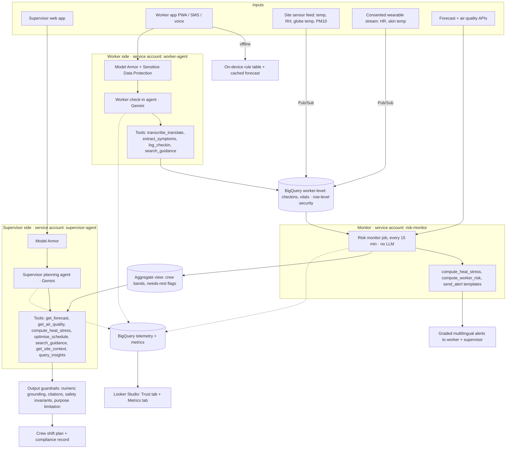

# Heat-Safe Crew Agent: Architecture & Build Plan (Abu Dhabi)

Revised 30 Oct 2026 · Future Health Digital Innovation Challenge · Population Health → **Climate-Resilient Worker Health**

## Overview

Two narrow agents and a deterministic risk monitor on GCP combine the heat forecast, site sensors, workload, PPE and optional consented wearable signals into a **graded, multilingual early warning per worker and per crew**. It turns that into a safe shift plan for the supervisor. It keeps working offline with a rule-based fallback, it keeps individual health data away from the employer, and it proves its own trustworthiness through guardrails, evals and BigQuery telemetry.

- **Persona:** a construction site supervisor in Mussafah, Abu Dhabi, planning shifts for a mixed crew of roofers, steel fixers and labourers in August. One persona, one region, end to end.
- **Second user:** the worker, who gets alerts and does check-ins in their own language on a basic phone.
- **Pitch line:** *Worker protection before productivity. Code computes and enforces, the LLM explains and plans, and every number and rule is grounded and logged.*

### What it does

1. Computes hourly heat stress per site as the **Thermal Work Limit (TWL)**, the index Abu Dhabi's ADOSH-SF CoP 11.0 requires, with WBGT alongside for display, from forecast and site-sensor data, then adjusts it per worker for workload, clothing/PPE, acclimatisation, hydration and cumulative exposure. This is all code, never the LLM.
2. Optionally adds consented wearable signals (heart rate, skin temperature) to estimate rising physiological strain per worker.
3. Sends **graded warnings** (Green / Amber / Red / Emergency) to workers in their language and to the supervisor, each with a fixed safe action: hydrate, rest, cool, reduce intensity, rotate, stop work or escalate clinically.
4. Plans the day for the supervisor: task timing, work/rest cycles, rotation and stop-work hours. It applies the UAE midday break as a hard rule and cites guidance for each recommendation.
5. Runs multilingual voice check-ins and escalates red-flag symptoms on a deterministic path.
6. Shows the supervisor **crew- and site-level views only**. Individual clinical detail never reaches them.
7. Reports safety and productivity metrics: alert lead time, false-alarm rate, adherence, symptoms and incidents, escalations, compliance and lost work time.
8. Shows a Trust tab: guardrail trips, eval pass rates, tool trajectories, latency and cost.

## Challenge fit

Each of the six "Your solution should" items maps to a concrete feature and a demo moment.

| # | Challenge requirement | How we meet it | Shown in demo |
|---|---|---|---|
| 1 | Dynamic heat-risk assessment | `compute_heat_stress` (site TWL zone, WBGT for display) plus `compute_worker_risk` (workload, PPE, acclimatisation, hydration, cumulative heat dose, optional HR / skin temperature) → individual and crew risk bands, updated every 15 minutes | Risk rises through the morning; the new starter turns Amber before the rest of the crew |
| 2 | Clear, graded, multilingual warnings | 4 severity levels; each level has fixed actions in **pre-translated, human-reviewed templates** (Arabic, Hindi, Urdu, Malayalam, Bengali, Tagalog, English); text-to-speech and SMS for basic phones | A Malayalam-speaking worker gets a Red alert with "stop, shade, water, tell supervisor" |
| 3 | Worker-first governance | Opt-in consent per data type, data minimisation, BigQuery row/column-level security, retention limits, purpose-limitation guardrail that refuses disciplinary or ranking queries | Supervisor asks "who complains most?" and the agent refuses; the refusal is logged |
| 4 | Field-ready operation | Offline-capable worker app (PWA) with an on-device rule table, SMS fallback, sensor-loss fail-safe that *raises* the risk band, stale-data detection, dust and PPE factors | Network cut mid-shift; the app still warns from cached forecast and rules; data syncs later |
| 5 | Supervisor decision support | Crew/site dashboard: risk by crew and hour, recommended breaks, rotation and task timing; individuals shown only as "needs rest now", never with vitals or symptoms | Morning plan moves roofing to 05:30–10:00 and adds a rotation |
| 6 | Safety and productivity measures | Metrics computed in BigQuery from a full-summer backtest with synthetic crews: lead time, false alarms, adherence, symptoms/incidents, escalations, compliance, lost work time | Metrics tab next to the Trust tab |

## Architecture

The system has two agents with separate data permissions and one non-agent pipeline. The worker's health data and the employer's planning tool never share credentials, so requirement 3 is enforced by IAM, not only by prompts. Alerts never wait on an LLM: the risk monitor fires them deterministically, and the same rule table runs offline on the worker's phone.

| Part | Type | Users | Can access |
|---|---|---|---|
| **Supervisor planning agent** | ADK agent (Gemini) on its own Cloud Run service and service account | Supervisor | Forecast, site heat stress, schedule optimiser, guidance search, site notes, **crew/site aggregate views only** |
| **Worker check-in agent** | ADK agent (Gemini), narrow scope, own Cloud Run service and service account | Worker | Speech-to-Text and translation, symptom extraction, that worker's own records, guidance search; emits only a band and a "needs rest" flag |
| **Risk monitor and alerting** | Not an agent: Pub/Sub + Cloud Run job every 15 min | — | Sensor and wearable streams, `compute_worker_risk`, pre-translated alert templates, `send_alert` |

The worker side reaches the supervisor side **only** through an aggregated BigQuery view (or an A2A message) carrying "Worker 7: Red, needs rest now". That handoff is requirement 5 built into the architecture.

## Components

Everything runs on GCP. Both agents are built with ADK on Cloud Run with Gemini, each with its own service account. BigQuery is the single store for data, vectors and telemetry, and Pub/Sub ingests sensor and wearable streams. Guardrails are Model Armor plus code checks. Shared tool code lives in one Python package (`src/heat_safe`), and each service imports only the tools it is allowed to use.

### Tools

Status as of 30 Oct 2026.

| Tool | What it does | Used by | Deterministic? | Priority | Status |
|---|---|---|---|---|---|
| `get_forecast` | Hourly temperature, humidity, wet bulb, surface pressure, wind, shortwave / direct / diffuse radiation and UV index (forecast only) for the configured sites (Open-Meteo). `get_replay(day)` **replays a past date** from the cached ERA5 files, falling back to the historical archive API | Supervisor agent, monitor | Yes | Must | Built: `forecast.py` |
| `compute_heat_stress` | Site TWL per hour (Brake & Bates 2002 heat balance; globe and natural wet bulb by the Liljegren method from forecast, or measured when a site sensor is present), in sun and in shade → ADOSH-SF TWL zone and risk band; withdrawal limits; WBGT for display; minutes of each hour inside the UAE midday break; work minutes per hour for light and heavy work; heat-programme flag at ≥ 35 °C; missing input → Red | Supervisor agent, monitor | Yes, pure code | Must | Built: `heat_stress.py`, `thermal.py`, `twl.py`, `rules.py`. Measured-sensor override not yet |
| `compute_worker_risk` | Applies the TWL zone controls for the worker's work intensity (light/heavy), adjusts for metabolic rate (task), clothing/PPE adjustment, acclimatisation days, cumulative heat dose and hydration; adds physiological strain from consented HR / skin temperature → individual band; aggregates to crew | Monitor only | Yes, pure code | Must | Week 2 (acclimatisation tables already in `rules.py`) |
| `lookup_job_profile` | Maps a role (roofer, steel fixer, labourer, driver, plus aliases) to ADOSH-SF work intensity (light/heavy), ISO 8996 metabolic class and rate, typical PPE, clothing insulation (clo) and O*NET heat-exposure context (US proxy) | Supervisor agent, monitor | Yes | Must | Built: `job_profile.py` |
| `get_air_quality` | PM10 / PM2.5 / dust for dust-storm days (Open-Meteo Air Quality, CAMS) | Supervisor agent, monitor | Yes | Should | Week 2 (data downloaded) |
| `get_site_context` | Retrieves today's pre-start notes and photo findings for the site | Supervisor agent | Retrieval | Must | Week 2 |
| `search_guidance` | RAG over the curated guidance corpus; returns chunks with citations | Both agents | Retrieval | Must | Week 2 (most documents downloaded) |
| `optimise_schedule` | Reorders tasks into cooler hours, inserts rest and rotation within risk-band rules; **never trades a safety rule for output** | Supervisor agent | Yes | Must | Week 2 |
| `transcribe_translate` | Speech-to-Text (Chirp) and translation of a voice check-in | Worker agent | Yes | Must | Week 3 |
| `extract_symptoms` | Gemini structured extraction of symptoms, hours worked and water intake | Worker agent | LLM, schema-checked | Must | Week 3 |
| `log_checkin` | Writes extracted check-in fields to BigQuery (worker-scoped table) | Worker agent | Yes | Must | Week 3 |
| `send_alert` | Sends a pre-translated template alert to an allowlisted worker or supervisor; rate-limited; level-gated | Monitor; worker agent for red-flag escalation only | Yes, side effect | Must | Week 3 |
| `query_insights` | Read-only SQL over **aggregated** analytics views only (crew/site, never per-worker health) | Supervisor agent | Yes, SQL-guarded | Should | Week 3 |

### Code layout

| Path | Content |
|---|---|
| `src/heat_safe/sites.py` | Site coordinates (`abu_dhabi_city`, `mussafah`, `al_ain`, `ruwais`) and time zone (Asia/Dubai) |
| `src/heat_safe/forecast.py` | `get_forecast`, `get_replay` |
| `src/heat_safe/thermal.py` | Solar zenith, globe temperature, natural wet bulb, mean radiant temperature, WBGT (thermofeel 2.3.0 Liljegren) |
| `src/heat_safe/twl.py` | Thermal Work Limit heat balance (port of the MIT-licensed R package meteoHazard) |
| `src/heat_safe/rules.py` | Versioned thresholds (`RULES_VERSION`): TWL zones and controls, withdrawal limits, acclimatisation, 35 °C programme trigger, midday break by year, `Band` ordering |
| `src/heat_safe/heat_stress.py` | `compute_heat_stress`, `daily_summary` |
| `src/heat_safe/job_profile.py` | `lookup_job_profile` |
| `tests/` | 103 tests: TWL against 63 published cases, zone and midday-break boundaries, fail-safe, replay day |
| `tools/download_data.py` | Downloads all public data, writes `data/manifest.json` |
| `tools/load_bigquery.py` | Creates the five datasets and loads `raw` tables |

### Risk model (code, not LLM)

1. **Site TWL** per hour (W/m²): computed from forecast (temperature, humidity, wind, solar → globe and mean radiant temperature) or measured when the site has a TWL meter. Measured values override forecast values. Computed both in sun and in shade, so the planner can move work into shade. Withdrawal limits (dry bulb > 44 °C or wet bulb > 32 °C) force the High zone.
2. **Zone → controls** from ADOSH-SF Technical Guideline v4.0 Table 1: Low (TWL ≥ 140) / Medium (115–140) / High (< 115) map to Green / Amber / Red, with work/rest cycles and fluid intake per work intensity (light or heavy). Unacclimatised workers may work only in the Low zone, and no one works alone in the Medium or High zone. PPE enters as clothing insulation in the TWL calculation per worker (default 0.6 clo, long-sleeved work wear). The midday break removes outdoor minutes from 12:30–15:00 before work/rest is applied, and any shift reaching 35 °C flags that a heat stress programme is required (CoP 11.0 §3.1).
3. **Modifiers** raise the band, never lower it: new worker or one back after > 14 days off (ADOSH-SF 5-day acclimatisation schedule: 20/40/60/80/100 % for new workers, 50/60/80/100 % for experienced), low reported water intake, symptoms in last check-in, high cumulative heat dose so far today, fasting during Ramadan, dust advisory (respirator use).
4. **Optional physiology** (consented only): estimated core temperature from heart rate (ECTemp-style Kalman filter) → Physiological Strain Index. A rising trend can raise the band early; missing data never lowers it.
5. **Crew risk** = the highest individual band in the crew plus the share of workers at Amber or above.
6. **Fail-safe:** a site-hour with a missing weather input has no environmental band to raise, so it is **Red** with a `data_issue` note (built). Stale forecast (> 3 h), sensor dropout or wearable loss → fall back to the environment-only band **plus one level**, and tell the supervisor which input is missing (Week 2). Raising caps at Red; **Emergency** comes only from red-flag symptoms, never from environment alone.

Thresholds live in versioned code (`rules.py`, `RULES_VERSION`) and are unit-tested. They are never retrieved from RAG or generated by the LLM.

### Graded warnings

| Level | Trigger (example) | Worker action (template) | Supervisor action |
|---|---|---|---|
| Green | TWL Low zone (≥ 140 W/m²), no modifiers | Drink water every 15–20 min | Normal plan |
| Amber | TWL Medium zone (115–140 W/m²), or Low zone plus one modifier | Drink 1 cup every 15 min, rest in shade at the scheduled break | Enforce work/rest cycle, rotate high-exertion tasks |
| Red | TWL High zone (< 115 W/m²) or a withdrawal limit, Medium zone plus a modifier, missing data, or a red-flag symptom trend | Stop, move to shade/cooling, drink, tell supervisor | Remove worker from heat, reassign task, check in within 10 min |
| Emergency | Red-flag symptoms (confusion, collapse, vomiting, stopped sweating) | Call for help; buddy stays with worker | Call **998**, start cooling, deterministic escalation |

Alert text comes from **fixed templates translated in advance and reviewed by native speakers**. The LLM can explain why an alert fired, but it never writes the safety instruction in a language nobody on the team can check.

### Unstructured inputs

| Input | Processing | Lands in | Priority |
|---|---|---|---|
| Worker voice check-ins | Speech-to-Text (Chirp) in the worker's language → Gemini extracts symptoms, hours, water intake | `checkins` (worker-scoped) | Must |
| Pre-start and handover notes | Gemini extracts risk factors (new starter, broken cooling unit, confined space, heavy PPE task) | `site_notes` + vector index | Must |
| Site photos | Gemini vision flags shade, water/cooling stations, PPE type | `site_photo_findings` | Stretch |
| Incident narratives (mock) | Extraction into structured fields + embedding | `incidents` + vector index | Should |

### RAG corpus

15–20 curated documents, chunked and embedded into BigQuery vector search (or Vertex AI RAG Engine if time is short). Thresholds are never retrieved; they live in `rules.py` and are applied by `compute_heat_stress` and `compute_worker_risk`. File locations and the full status list are under [Data sources](#data-sources).

- **Have:** ADOSH-SF CoP 11.0 *Safety in the Heat* v4.0 and its Technical Guideline v4.0 (Jul 2024, issued through the Abu Dhabi Public Health Centre); ADOSH-SF CoP 53.1 *OSH in Construction*; ILO *Working on a warmer planet* (2019); NIOSH 2016-106 heat-stress criteria; WHO/WMO *Heatwaves and health: guidance on warning-system development* (2015); WHO heat fact sheet; Sharjah OSHJ-CoP-33 (2024, reference only, not Abu Dhabi law); UAE PDPL (FDL 45/2021, English); Federal Law 2/2019 on ICT in health; DoH ADHICS FAQ
- **To collect by hand:** MoHRE midday-break announcements (2024, 2025); NCM warning text samples (extreme heat, dust, fog); WHO/WMO *Climate change and workplace heat stress* (2025); MoHRE Ramadan working hours and the Labour Law (FDL 33/2021); CoP 11.0 in Arabic
- **To write (mock):** contractor heat-stress management plan, labour accommodation and transport note, site emergency response plan

## Worker-first governance

The worker owns their health data, the supervisor sees actions, and nobody sees rankings. Every rule below is enforced in code or IAM, not just in a prompt.

| Control | Implementation | Priority |
|---|---|---|
| Informed consent | Consent screen in the worker's language, separate opt-in for check-ins, wearable HR and skin temperature; withdraw any time; consent state checked before every read | Must |
| Data minimisation | Store only what the risk model uses; no location tracking beyond site check-in; no raw audio kept after transcription | Must |
| Agent separation | Supervisor agent's service account has no IAM access to worker-level tables; only the worker agent and the risk monitor can read them | Must |
| Access rules | BigQuery row-level security and policy tags: supervisor role sees crew aggregates and "needs rest" flags; only the worker (and an occupational health role) sees individual vitals and symptoms | Must |
| Purpose limitation | Guardrail refuses queries that rank, score or compare individual workers for performance, discipline, hiring or attendance; refusals logged to telemetry | Must |
| Retention | Table/partition expiration on worker-level health data (e.g. 30 days in the prototype); aggregates kept longer | Should |
| Audit | Cloud Audit Logs plus agent telemetry show who accessed which worker-level data | Should |
| Regulatory alignment | Document alignment with UAE Federal Decree-Law 45/2021 (PDPL) and Abu Dhabi DoH health data rules; listed as an assumption for legal review, not a claim of compliance | Should |

## Field-ready operation

The worker app and the alert path must work without the LLM and without the network. A hackathon cannot run a summer field trial, so we demonstrate this with fault-injection tests and a replayed summer day.

| Condition | Fallback | Test |
|---|---|---|
| Network loss on site | PWA keeps the cached forecast and the rule table and alerts locally; check-ins queue and sync later; SMS for basic phones | Airplane-mode demo; queued check-in syncs |
| Sensor or wearable failure | Environment-only band **+1 level**; supervisor told which input is missing | Kill the simulated sensor stream mid-replay |
| Stale or missing forecast | Last good forecast + conservative band; alert after 3 h stale | Block the API in the test harness |
| Dust storm | Dust raises the band (respirator effort) and shows a dust advisory | Replay a past dust event |
| Heavy PPE / coveralls | Clothing adjustment in `compute_worker_risk` | Golden scenarios per PPE type |
| Battery | Low-frequency wearable sampling; the app works on a basic phone via SMS | Documented as an assumption |
| Agent or guardrail error | Fail safe: escalate instead of going silent | Golden eval scenarios |

## Supervisor decision support

- **Site view:** hourly risk band per crew for today and tomorrow, with the midday break and recommended stop-work windows marked.
- **Crew plan:** recommended task order, work/rest cycles, rotation between high- and low-exertion tasks, and the guidance cited for each.
- **Live board:** count of workers at each band and "needs rest now" actions. Individuals appear by name or ID only with an action, never with vitals, symptoms or history.
- **Natural-language questions** through `query_insights`, limited to aggregated views ("How many Red alerts did crew B have this week?").

## Safety and productivity measures

All metrics are computed in BigQuery views and shown in a Looker Studio Metrics tab. For the prototype they come from a **backtest over a full past Abu Dhabi summer (Jun–Sep) with synthetic crews**. The synthetic heat-illness events come from a documented simulation, and we label them that way.

| Metric | Definition (prototype) |
|---|---|
| Alert lead time | Minutes between the first Amber/Red alert and a simulated symptom onset event |
| False-alarm rate | Share of Red alerts with no exceedance or symptom within the following 60 min |
| Missed-event rate | Simulated symptom events with no prior Amber or higher alert (target: 0 in golden set) |
| Adherence | Share of recommended breaks and rotations acknowledged in the app |
| Symptoms and incidents | Check-in symptom reports and incidents per 1,000 worker-hours, by band |
| Emergency escalations | Count and time-to-supervisor-acknowledgement |
| Compliance | Share of shifts with zero outdoor work in the midday break window, and with rest cycles applied |
| Lost work time | Hours moved or stopped for heat, versus a no-plan baseline |

## Guardrails

| Layer | Guardrail | Built with | Priority |
|---|---|---|---|
| Input | Prompt injection and jailbreak screening on check-in text and transcripts | Model Armor | Must |
| Input | PII and health-data redaction before embedding or logging | Sensitive Data Protection / Model Armor | Must |
| Tool | SQL guard: SELECT only, allowlisted **aggregate** views, dry run, `maximum_bytes_billed` | sqlglot + BigQuery dry run; read-only service account | Must |
| Tool | `send_alert`: recipient allowlist, rate limit, template-only text, human approval for non-standard alerts | Code | Must |
| Tool | Consent check before any worker-level read | Code + IAM | Must |
| Agent boundary | Separate service accounts per agent; the supervisor agent cannot read worker-level tables even if prompted to | IAM | Must |
| Output | Numeric grounding: every TWL / WBGT / temperature / band matches tool output | Code | Must |
| Output | Safety invariants: no "safe to continue" at Red or above; no outdoor work planned in the midday break window; red flags always escalate | Code | Must |
| Output | Purpose limitation: no individual ranking, scoring or disciplinary framing | Code + Model Armor | Must |
| Output | Citation check: policy claims map to a retrieved chunk | Code | Should |
| Output | Medical-advice boundary; 998 path present when needed | Code + Model Armor | Should |
| Any | Fail safe: a guardrail or tool error during a check-in escalates instead of going silent | Code | Must |

## Evals

- **Golden set** of 20–25 scenarios, split into a supervisor-agent suite and a worker-agent suite, with expected tool trajectories, scored with trajectory metrics (exact, in-order, precision, recall) in ADK eval or the Vertex AI evaluation service. Include scenarios for PPE types, new starters, Ramadan, dust, sensor dropout, offline mode and purpose-limitation red-team prompts.
- **Risk model unit tests:** TWL against Brake & Bates (2002) Table 1 (63 published cases); WBGT against the thermofeel reference implementation; band boundaries; midday-break boundaries; "missing data never lowers risk" (103 tests, all passing).
- **Response metrics:** correctness against computed values, invariant pass rate, safety.
- **RAG metrics:** faithfulness, context precision and recall.
- **Extraction metrics:** symptom recall on gold check-in transcripts in each language; a missed red flag fails the run.

## Observability

Agent events, tool calls, guardrail decisions and eval results stream to BigQuery via ADK's BigQuery logging plugin. Sensor and wearable streams arrive through Pub/Sub. Looker Studio shows two tabs:

- **Trust tab:** guardrail trips by type, refusals, tool error rates, latency and token cost per run, eval pass rates over time.
- **Metrics tab:** the safety and productivity measures above.

## Data sources

Weather, air quality, standards, guidance and occupation data are real and public. Anything about specific workers, sites, wearables or incidents is synthetic and labelled that way in the demo.

`uv run python tools/download_data.py` fetches every automatic source (idempotent; `--force` refreshes) and records each file's URL, retrieval time and status in `data/manifest.json`. Last run: 48 files, 0 failures. `uv run python tools/load_bigquery.py` loads the tabular data into BigQuery `raw` in `YOUR_PROJECT_ID` (me-central1), replacing each table on every run. `data/raw/` and `data/processed/` are gitignored, so a fresh clone runs the script first. Hourly times are local (Asia/Dubai); sites are in `src/heat_safe/sites.py`. Inventory details: `data/README.md`.

#### Real data: downloaded

Paths are under `data/`.

| Data | Source | Coverage | Path | BigQuery `raw` table (rows) | Used by |
|---|---|---|---|---|---|
| Hourly forecast | [Open-Meteo Forecast API](https://open-meteo.com/en/docs), no key | 16 days, 4 sites, incl. UV; one snapshot per download day (29 and 30 Oct 2026) | `raw/weather/forecast_snapshot_<date>.csv` | `weather_forecast_snapshot` (3,072) | `get_forecast` live path |
| Historical hourly weather | [Open-Meteo Historical API](https://open-meteo.com/en/docs/historical-weather-api) (ERA5) | Replay days 1 Aug 2025 (heat) and 4 Aug 2024 (dust); 1 Jun–30 Sep 2023, 2024, 2025; 4 sites | `raw/weather/era5_*.csv` | `weather_era5_hourly` (35,136) | `get_replay`, backtest, Metrics tab |
| Air quality and dust | [Open-Meteo Air Quality API](https://open-meteo.com/en/docs/air-quality-api) (CAMS) | PM10, PM2.5, dust, aerosol optical depth, UV, US AQI: forecast snapshots, both replay days, summers 2023–2025 | `raw/air_quality/` | `air_quality_cams_hourly` (35,136), `air_quality_forecast_snapshot` (960) | `get_air_quality`, dust modifier |
| Station observations | NOAA NCEI GSOD | Daily 2020–2025: Abu Dhabi Intl, Al Bateen, Al Ain Intl | `raw/noaa_gsod/` | `noaa_gsod_daily` (6,125; missing-value sentinels left in) | Validate ERA5 |
| Reanalysis cross-check | NASA POWER | Mussafah hourly for both replay days; daily summers 2023–2025 | `raw/nasa_power/` | `nasa_power_hourly` (48), `nasa_power_daily` (366) | Cross-check ERA5 |
| Occupation exposure | O*NET 30.1 Work Context (US proxy, labelled as such) | Full database, plus an extract for the four roles | `raw/onet/`, `processed/onet_work_context_plan_roles.csv` | `onet_work_context` (297,676), `onet_work_context_categories` (281), `onet_occupation_data` (1,016) | `lookup_job_profile` |
| Abu Dhabi heat code | ADPHC: ADOSH-SF CoP 11.0 *Safety in the Heat* v4.0 and Technical Guideline v4.0 (Jul 2024) | TWL zones, work/rest, fluid, acclimatisation, heat programme | `raw/regulatory/adosh_sf_*_safety_in_the_heat_v4_2024_en.pdf` | — | `rules.py`, RAG corpus |
| Construction OSH code | ADPHC: ADOSH-SF CoP 53.1 *OSH in Construction* | | `raw/regulatory/adosh_sf_cop_53_1_osh_construction_en.pdf` | — | RAG corpus |
| Code of practice index | ADPHC Codes of Practice page | Version check for CoP 11.0 | `raw/regulatory/adphc_codes_of_practice_index.html` | — | Citation reference |
| Guidance | ILO 2019; NIOSH 2016-106; WHO/WMO 2015 warning systems; WHO heat fact sheet; Sharjah OSHJ-CoP-33 (2024, reference only) | | `raw/guidance/` | — | RAG corpus |

#### Real data: collected by hand

In `data/raw/regulatory/manual/`, listed in the manifest with status `manual`.

| Data | File | Used by |
|---|---|---|
| TWL zone table, transcribed from Technical Guideline v4.0 Table 1 (p. 5) and checked against the PDF | `twl_zones_adosh_tg_v4.csv` | Source record for the values in `rules.py` (`RULES_VERSION` 2026.10.30-1) |
| UAE PDPL, Federal Decree-Law 45/2021 (English) | `uae_pdpl_fdl_45_2021_en.pdf` | Governance, RAG corpus |
| Federal Law 2/2019 on ICT in health fields | `uae_health_ict_law_2_2019_en.pdf` | Governance, region assumption |
| Abu Dhabi DoH ADHICS FAQ | `ADHICS-FAQ.pdf` | Governance |

#### Real data: still to collect by hand

Steps and file names: `doc/manual-data-collection.md`. These sites block scripts or have no stable file link.

| Priority | Data | Needed for | By |
|---|---|---|---|
| 1 | MoHRE midday-break announcements 2025 and 2024 (exemptions, fines) | Citation for the midday-break dates in `rules.py`; RAG corpus | Week 2 |
| 1 | PDPL Arabic text and any executive regulations; Cabinet Resolution 32/2020 (executive regulation of Law 2/2019); full ADHICS standard | Governance section, data-localisation assumption | Week 3 |
| 2 | NCM warning text samples, English and Arabic (extreme heat, dust, fog) | RAG corpus, alert template wording | Week 2 |
| 2 | WHO/WMO *Climate change and workplace heat stress* (2025) | RAG corpus | Week 2 |
| 2 | MoHRE Ramadan working hours; Labour Law FDL 33/2021 and Cabinet Resolution 1/2022 | Rationale for the Ramadan modifier, RAG corpus | Week 2 |
| 2 | CoP 11.0 in Arabic | Arabic alerts and citations | Week 3 |
| 3 | EAD station PM10 / PM2.5 near Mussafah | Validating CAMS dust | Week 4 |
| 3 | Statistics Centre Abu Dhabi / FCSC construction labour statistics | Pitch, Metrics tab | Week 4 |

The UAE [National Center of Meteorology](https://www.ncm.gov.ae/) is the official forecast reference; we cite it but do not ingest it.

#### Synthetic data: to create

| Data | Content | Used by | By |
|---|---|---|---|
| Synthetic crews | Roles, acclimatisation day, days off, PPE, language, consent flags | `compute_worker_risk`, backtest | Week 2 |
| Site sensor feed | Simulated from the replayed forecast with noise, dropouts and dust | Pub/Sub → BigQuery | Week 2 |
| Wearable signals (HR, skin temp) | Per-worker streams driven by workload and site TWL; consent flags | `compute_worker_risk` | Week 2 |
| Pre-start notes, site photos | Written / photographed for the demo | `get_site_context` | Week 2 |
| Contractor heat plan, accommodation/transport note, emergency plan | Written for the demo | RAG corpus | Week 2 |
| Alert templates | Four levels in English + 3 worker languages, reviewed by native speakers | `send_alert`, offline rule table | Week 3 |
| Voice check-ins | Recorded by the team in 2–3 of: Arabic, Hindi, Urdu, Malayalam, Bengali, Tagalog | Check-in flow, extraction evals | Week 3 |
| Incident narratives, symptom events | Written / simulated with a documented model | Incident retrieval, backtest metrics | Week 3–4 |
| Golden eval scenarios | Written by the team | Evals | From Week 1 |

#### Data limitations

- ERA5 and CAMS are 10–40 km grids: no site microclimate (roof surfaces, reflected heat, urban heat island). Mussafah and Abu Dhabi city fall in the same air-quality cell, so their values are identical.
- ERA5 has no UV index; it exists only in the forecast and CAMS data.
- Globe temperature from forecast radiation gives mean radiant temperatures of 80–95 °C in full sun, so sun TWL sits at the model's 60 W/m² floor from 09:00 to 16:00 on the replay day. This is probably conservative for clothed workers. Shade TWL is computed alongside; both still need checking against measured TWL or published Gulf field data.
- The free Open-Meteo API is for non-commercial use. A pilot needs the paid customer API, which `forecast.py` already supports with an API key.
- O*NET describes US jobs; it is context only, never a threshold.

**Demo timing:** Abu Dhabi in late November is around 30 °C, so a live forecast on judging day will not show a heat emergency, and the midday break does not apply. The demo **replays a real past August day** (1 Aug 2025: 45.0 °C, peak WBGT 40.0 °C) from the cached ERA5 file through `get_replay`. The live forecast is shown briefly to prove the real data path works. The cached replay also covers the live-demo failure risk.
